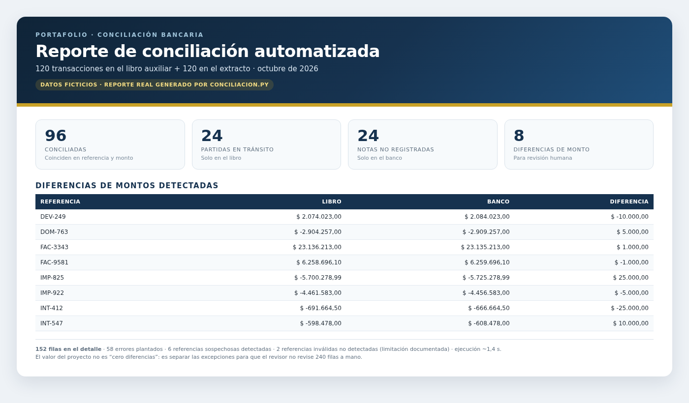

# Conciliación Bancaria Automatizada con Python y Pandas

Automatiza la **conciliación bancaria**: cruza el libro auxiliar de la empresa con el extracto bancario, clasifica cada transacción y genera un reporte en Excel listo para revisión manual. El proyecto incluye un **notebook** (`concilicacion.ipynb`) y un **script** (`conciliacion.py`) con la misma lógica.

## Características

- 📥 Lee las hojas `Libro_Auxiliar` y `Extracto_Bancario` de un archivo Excel.
- 🔁 Marca los **duplicados en cada hoja por separado** (antes del merge) y clasifica su origen.
- 🔍 Detecta **referencias sospechosas**: pares que casi coinciden pero difieren por espacios, mayúsculas o guiones (normalización con `strip`/`upper`).
- ⚖️ Clasifica cada transacción en `Estado_Final`: `Conciliado`, `Diferencia de Montos`, `Partida en Tránsito`, `Nota no Registrada` o `Revisión Manual`.
- 📤 Exporta un reporte Excel con **4 hojas**: detalle, resumen ejecutivo, referencias sospechosas y partidas sin contrapartida.

## Formas de ejecutarlo

### Script (recomendado)

```bash
python conciliacion.py
```

Pide el nombre de un archivo ubicado en `datos_prueba/` (Enter usa `Datos_Prueba_01.xlsx`) y genera el reporte `datos_prueba/Reporte_<nombre>.xlsx`:

```
Archivos disponibles en datos_prueba/:
  - Control_01.xlsx
  - Datos_Prueba_01.xlsx
Nombre del archivo a procesar (Enter = Datos_Prueba_01.xlsx):
```

### Notebook

```bash
jupyter notebook concilicacion.ipynb
```

Dentro del notebook: **Kernel → Restart & Run All**. Genera `Reporte_Conciliacion_Automatizada.xlsx` en la raíz.

## Flujo del proceso

```
Archivo de datos (Libro_Auxiliar + Extracto_Bancario)
   │
   ├─ 1) Lee ambas hojas y marca duplicados por hoja (Duplicado_Libro / Duplicado_Banco)
   │
   ├─ 2) Detecta referencias sospechosas y sin contrapartida (normalización)
   │
   ├─ 3) Merge outer por Referencia
   │
   ├─ 4) Columnas de análisis:
   │      Coinciliado, Partida en Tránsito / Nota no Registrada,
   │      Diferencia de Montos, Estado_Final, Origen_Duplicado
   │
   ├─ 5) Exporta el reporte Excel (4 hojas)
   │
   └─ 6) Imprime el resumen en pantalla
```

## Estructura del proyecto

```
conciliacion/
├── conciliacion.py                # Script principal (misma lógica que el notebook)
├── concilicacion.ipynb            # Notebook interactivo
├── Datos_Prueba.xlsx              # Datos de prueba pequeños (pruebas rápidas)
├── datos_prueba/                  # Carpeta de conjuntos de prueba generados
│   ├── Datos_Prueba_01.xlsx       # 120+120 filas, 58 errores plantados
│   ├── Control_01.xlsx            # Tabla de control de los errores plantados
│   ├── PROMPT_GENERADOR_DATOS.md  # Prompt reutilizable para generar más conjuntos
│   └── Reporte_*.xlsx             # Reportes generados por el script (gitignored)
├── Guia_Estudio_Conciliacion_Bancaria.pdf   # Guía de estudio completa
├── README.md
└── conciliacion/                  # Entorno virtual (gitignored)
```

## Requisitos

- Python **3.12+** (el notebook usa comillas anidadas en f-strings, disponibles desde Python 3.12)
- [pandas](https://pandas.pydata.org/) (DataFrames, lectura de Excel, merge)
- [numpy](https://numpy.org/) (`np.where`, `np.select`, valores `NaN`)
- [openpyxl](https://openpyxl.readthedocs.io/) (motor de escritura de Excel)

## Instalación

```bash
python -m venv venv
source venv/bin/activate        # Windows: venv\Scripts\activate
pip install pandas openpyxl     # numpy se instala automáticamente con pandas
```

## Reporte generado

| Hoja | Contenido |
|---|---|
| `Detalle_Conciliacion` | Todas las transacciones con su estado, diferencias y duplicados |
| `Resumen_Ejecutivo` | Cantidad de transacciones por estado |
| `Referencias_Sospechosas` | Pares con errores de formato (espacios, mayúsculas, guiones) |
| `Sin_Contrapartida` | Referencias que no existen en el otro lado, con su origen |

## Datos de prueba

**Conjunto pequeño** (`Datos_Prueba.xlsx` en la raíz, para pruebas rápidas):
- `Libro_Auxiliar` — 25 filas y `Extracto_Bancario` — 30 filas
- Incluye duplicados, errores de formato, diferencias de montos, partidas y notas.

**Conjunto grande** (`datos_prueba/Datos_Prueba_01.xlsx`, para pruebas completas):
- 120 filas por hoja, octubre de 2026, semilla 482916
- **58 errores plantados** documentados en `Control_01.xlsx`: 10 referencias duplicadas, 8 errores de formato, 8 montos diferentes, 30 unilaterales legítimas y 2 referencias inválidas.

Para generar más conjuntos distintos, usa [`datos_prueba/PROMPT_GENERADOR_DATOS.md`](datos_prueba/PROMPT_GENERADOR_DATOS.md) con un agente de código.

## Resultado actual (conjunto grande)

**Entrada:** 120 filas en `Libro_Auxiliar` + 120 filas en `Extracto_Bancario`.  
**Salida:** 152 filas en `Detalle_Conciliacion` después del merge y la expansión de duplicados.

```
96 conciliadas, 24 partidas en tránsito, 24 notas no registradas, 8 diferencias de montos.
```

| Estado | Cantidad |
|---|---:|
| Conciliado | 96 |
| Partida en Tránsito | 24 |
| Nota no Registrada | 24 |
| Diferencia de Montos | 8 |
| **Total de filas del detalle** | **152** |

### Impacto del reporte

- **120 transacciones por hoja** procesadas sin revisión manual fila por fila.
- **58 errores plantados** en el conjunto de prueba.
- **8 diferencias de montos** quedan separadas para revisión humana.
- **24 notas no registradas** y **24 partidas en tránsito** se clasifican por separado.
- **6 pares de referencias sospechosas** se detectan por normalización.
- **2 referencias inválidas** no se detectan automáticamente por formato; quedan como limitación documentada.
- **Tiempo de ejecución:** ~1,4 segundos en este equipo (no se midió el tiempo de una revisión manual equivalente).

**Lectura correcta:** el proyecto no promete “cero diferencias”. Promete **separar las excepciones** para que el revisor no tenga que revisar 240 filas a mano. El revisor se concentra en las 8 diferencias de monto y en las referencias que requieren criterio.



*Captura generada a partir de `Reporte_Datos_Prueba_01.xlsx` con datos ficticios.*

## Documentación

La explicación completa (conceptos contables, librerías, funciones utilizadas y su porqué, flujo del notebook y del script, errores comunes y buenas prácticas) está en **[Guia_Estudio_Conciliacion_Bancaria.pdf](Guia_Estudio_Conciliacion_Bancaria.pdf)**.

Presentación corta: **[Deck de 5 diapositivas (PDF)](docs/decks/Deck_Conciliacion_5_Slides.pdf)** · **[PPTX editable](docs/decks/Deck_Conciliacion_5_Slides.pptx)**.

## Limitaciones y próximos pasos

- El proyecto **detecta y reporta**, pero no corrige los datos automáticamente: la corrección se hace en el Excel de origen y se re-ejecuta.
- Posibles mejoras: comparar montos con tolerancia de decimales, detectar duplicados "parciales" (misma referencia, distinto monto), normalización que ignore ceros a la izquierda (hoy `CHQ-0929` no se detecta como sospechoso) y agregar gráficos de resumen.
